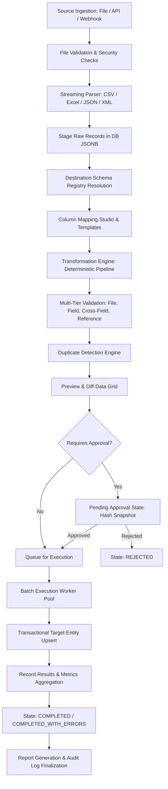

# Data Import Centre — Comprehensive Technical Architecture

This document presents the complete system architecture for the enterprise-grade **Data Import Centre**. It provides an exhaustive blueprint for data ingestion, schema discovery, dynamic mapping, deterministic transformation, multi-tier validation, duplicate resolution, approval gating, asynchronous batch execution, and full lifecycle auditability.

---

## 1. Executive Architecture

The **Data Import Centre** is designed as a high-throughput, multi-tenant data ingestion and ETL platform. It decouples high-volume file ingestion and staging from transactional database mutations via an asynchronous, event-driven worker architecture.

### Key Architectural Pillars
- **Zero Data Loss & Full Traceability**: Raw records are staged immutably alongside transformed records, with cell-level error and diff tracking.
- **Tenant Isolation by Construction**: Every query, staged row, template, and worker job executes in strict tenant context (`organization_id`).
- **Memory-Bounded Streaming**: Chunked and streaming file parsers guarantee stable memory footprints even with hundreds of thousands of rows.
- **Schema-Driven Extensibility**: A unified `SchemaRegistry` serves as the single source of truth for mapping, validation, transformation, preview, and execution across all business entities.
- **Deterministic & Auditable Lifecycle**: Governed by a strict state machine with cryptographic approval invalidation on data/mapping tampering.

---

## 2. Component Architecture

```
+-----------------------------------------------------------------------------+
|                               FRONTEND LAYER                                |
|  [Import Wizard]  [Mapping Studio]  [Preview & Diff Grid]  [History / Logs]  |
+-----------------------------------------------------------------------------+
                                       │ REST / SSE / WebSockets
                                       ▼
+-----------------------------------------------------------------------------+
|                             API GATEWAY & GUARDS                            |
|     [Auth & RBAC Guard]     [Tenant Context Middleware]     [Rate Limiter]  |
+-----------------------------------------------------------------------------+
                                       │
            ┌──────────────────────────┴──────────────────────────┐
            ▼                                                     ▼
+───────────────────────────+                         +───────────────────────+
|   IMPORT CONTROLLER API   |                         |  SCHEMA REGISTRY API  |
|  - Ingestion / Upload     |                         |  - Entity Schemas     |
|  - Mapping & Templates    |                         |  - Field Rules        |
|  - Validation & Preview   |                         |  - Relation Resolvers |
|  - Approvals & Triggers   |                         +───────────────────────+
+───────────────────────────+
            │
            ▼
+─────────────────────────────────────────────────────────────────────────────+
|                             APPLICATION CORE                                |
|  [Source Ingestor]  [Mapping Engine]  [Transform Engine]  [Validation Engine]  [Duplicate Detector]  |
+─────────────────────────────────────────────────────────────────────────────+
            │
            ├──────────────────────────┐
            ▼                          ▼
+─────────────────────────+  +────────────────────────────────────────────────+
|   ASYNC JOB QUEUE       |  |              PERSISTENCE & STORAGE             |
|  (Parsing & Exec Jobs)  |  |  - PostgreSQL (Staging, Metadata, Audits)      |
+─────────────────────────+  |  - Object Storage (Raw Files, Export Reports)  |
            │                +────────────────────────────────────────────────+
            ▼
+─────────────────────────────────────────────────────────────────────────────+
|                           WORKER EXECUTION POOL                             |
|  [Streaming Parsers]   [Batch Execution Engine]   [Audit / Report Worker]   |
+─────────────────────────────────────────────────────────────────────────────+
            │
            ▼
+─────────────────────────────────────────────────────────────────────────────+
|                         TARGET APPLICATION ENTITIES                         |
|      (Contacts, Invoices, Orders, Products, Ledgers, Custom Entities)       |
+─────────────────────────────────────────────────────────────────────────────+
```

---

## 3. Backend Architecture

The backend is structured into clean modular layers:

1. **Presentation / API Layer**: REST endpoints for wizard coordination, mapping manipulation, preview fetching, approval decisions, execution initiation, and report downloading.
2. **Domain & Services Layer**:
   - `SourceIngestionService`: File validation, MIME checking, multipart chunk reassembly.
   - `SchemaRegistryService`: Entity definitions, field metadata, data types, relation lookups.
   - `MappingService`: Auto-matching heuristics, mapping validation, template persistence.
   - `TransformationService`: Deterministic pipeline (casing, trimming, dates, phone, lookups).
   - `ValidationService`: 4-tier validation engine (file, field, cross-field, reference).
   - `DuplicateService`: Detection by unique key / composite business keys, resolution routing.
   - `ApprovalService`: Policy evaluation, approver assignment, checksum snapshot hashing.
   - `ExecutionCoordinator`: Batch transaction management, rollback coordination, record retry.
   - `AuditService`: Immutable event recording and hash verification.
3. **Worker Layer**:
   - `FileParserWorker`: Offloaded background parsing for large files (>5MB or >5,000 rows).
   - `BatchExecutionWorker`: High-concurrency, chunked transactional writer to target tables.
   - `ReportGenerationWorker`: Asynchronous compilation of exportable error/audit reports.

---

## 4. Frontend Architecture

The frontend is an interactive, responsive Single Page Application (SPA) structured as:

1. **Import Wizard (9-Step State Machine Driven UI)**:
   - *Step 1: Source Selection* (File Upload, API Connector, Internal Query).
   - *Step 2: Destination Entity Selection* (Dynamic cards from Schema Registry).
   - *Step 3: Upload & File Validation* (Drag-and-drop, chunked progress, checksum check).
   - *Step 4: Import Options* (Batch size, header row index, timezone, duplicate strategy).
   - *Step 5: Column Mapping Studio* (Interactive matching, suggestions, default values, transforms).
   - *Step 6: Validation & Dry-Run* (Progress spinner, error summary by severity).
   - *Step 7: Review & Diff Grid* (Side-by-side original vs. transformed, filterable errors).
   - *Step 8: Processing / Live Execution* (Real-time progress bar, throughput metrics, cancel button).
   - *Step 9: Completion & Report* (Success metrics, error download, retry failed records button).
2. **Management Views**:
   - `Data Import Centre Dashboard`: Metric widgets (Active, Completed, Failed, Pending Approval), recent imports.
   - `Import History`: Paginated, multi-filter table (Date, Entity, Status, User).
   - `Import Details`: Deep-dive inspection into mappings, staged records, audit timeline, executions.
   - `Template Manager`: CRUD operations on reusable column mappings.
   - `Approval Queue`: Dedicated view for authorized managers to review and sign off on gated imports.

---

## 5. Database Architecture

Detailed in [DATA_IMPORT_DATABASE_DESIGN.md](file:///c:/Users/laxmi/OneDrive/Desktop/data-import-center/DATA_IMPORT_DATABASE_DESIGN.md).

Core Relational Entities:
- `data_import_sources`: Configured source endpoints and credentials.
- `data_imports`: Master import jobs tracking lifecycle and overall counts.
- `data_import_mappings`: Saved column associations, transformations, and default values.
- `data_import_templates`: Versioned reusable mapping definitions.
- `data_import_records`: Staged rows with original `raw_data`, `transformed_data`, and `validation_errors`.
- `data_import_approvals`: Approval workflows, decisions, reasons, and tamper hashes.
- `data_import_executions`: Execution batch runs, duration, and worker locks.
- `data_import_audit_logs`: Append-only, chronological event trail.

---

## 6. Complete Import Pipeline



---

## 7. Import State Machine

### 7.1 State Transition Diagram

```
           ┌───────────┐
           │   DRAFT   │
           └─────┬─────┘
                 │ (Upload File / Select Source)
                 ▼
          ┌─────────────┐
          │  UPLOADED   │
          └──────┬──────┘
                 │ (Trigger Parse)
                 ▼
          ┌─────────────┐         (Parse Error)         ┌───────────┐
          │   PARSING   │──────────────────────────────▶│  FAILED   │
          └──────┬──────┘                               └───────────┘
                 │ (Parse Complete)                           ▲
                 ▼                                            │
          ┌─────────────┐                                     │
          │   PARSED    │                                     │
          └──────┬──────┘                                     │
                 │ (Configure Columns)                        │
                 ▼                                            │
          ┌─────────────┐                                     │
          │   MAPPING   │                                     │
          └──────┬──────┘                                     │
                 │ (Save Valid Mapping)                       │
                 ▼                                            │
          ┌─────────────┐                                     │
          │   MAPPED    │                                     │
          └──────┬──────┘                                     │
                 │ (Trigger Dry-Run Validation)               │
                 ▼                                            │
          ┌─────────────┐                                     │
          │ VALIDATING  │                                     │
          └──────┬──────┘                                     │
                 ├──(Blocking Errors)──▶ ┌───────────────────┐│
                 │                       │ VALIDATION_FAILED ││
                 ▼                       └─────────┬─────────┘│
          ┌─────────────┐                          │ (Fix Map)│
          │  VALIDATED  │◀─────────────────────────┘          │
          └──────┬──────┘                                     │
                 │                                            │
         ┌───────┴────────────────────────┐                   │
         │ (Requires Approval)            │ (No Approval Req) │
         ▼                                ▼                   │
  ┌────────────────────┐            ┌───────────┐             │
  │  PENDING_APPROVAL  │            │  QUEUED   │             │
  └────────┬───────────┘            └─────┬─────┘             │
     ┌─────┴──────────────┐               │                   │
(Approved)            (Rejected)          ▼                   │
     ▼                    ▼         ┌───────────┐             │
┌───────────┐      ┌───────────┐    │PROCESSING │             │
│ APPROVED  │      │ REJECTED  │    └─────┬─────┘             │
└─────┬─────┘      └───────────┘          │                   │
      │                                   │                   │
      └───────────────────────────────────┤                   │
                                          │                   │
                                          ▼                   │
                     ┌────────────────────┴────────────────┐  │
                     │ (All Succeeded)     (Some Failed)   │  │
                     ▼                     ▼               │  │
              ┌─────────────┐   ┌────────────────────────┐ │  │
              │  COMPLETED  │   │ COMPLETED_WITH_ERRORS  │ │  │
              └─────────────┘   └────────────────────────┘ │  │
                     ▲                                     │  │
                     │ (Retry Remaining Failed Records)    │  │
                     └─────────────────────────────────────┘  │
                                                              │
                     (Unrecoverable System / DB Crash)        │
                     └────────────────────────────────────────┘
```

### 7.2 State Transition Matrix

| From State | Allowed Transitions | Triggered By | Approval Needed? | Execution Allowed? |
|---|---|---|---|---|
| `DRAFT` | `UPLOADED`, `FAILED`, `CANCELLED` | User / API | No | No |
| `UPLOADED` | `PARSING`, `DRAFT`, `CANCELLED` | System / User | No | No |
| `PARSING` | `PARSED`, `FAILED` | Worker | No | No |
| `PARSED` | `MAPPING`, `CANCELLED` | User | No | No |
| `MAPPING` | `MAPPED`, `PARSED`, `CANCELLED` | User | No | No |
| `MAPPED` | `VALIDATING`, `MAPPING`, `CANCELLED` | User | No | No |
| `VALIDATING` | `VALIDATED`, `VALIDATION_FAILED`, `FAILED` | Worker | No | No |
| `VALIDATION_FAILED` | `MAPPING`, `VALIDATING`, `CANCELLED` | User | No | No |
| `VALIDATED` | `PENDING_APPROVAL`, `QUEUED`, `MAPPING`, `CANCELLED` | System / User | If rule matches | If no approval req |
| `PENDING_APPROVAL` | `APPROVED`, `REJECTED`, `MAPPING`, `CANCELLED` | Approver Role | Yes (in progress) | No |
| `APPROVED` | `QUEUED`, `MAPPING` (triggers invalidation), `CANCELLED` | User / System | Yes (Satisfied) | Yes |
| `REJECTED` | `MAPPING`, `DRAFT`, `CANCELLED` | User | No | No |
| `QUEUED` | `PROCESSING`, `CANCELLED` | Queue Worker | Must be satisfied | Yes |
| `PROCESSING` | `COMPLETED`, `COMPLETED_WITH_ERRORS`, `FAILED`, `CANCELLED` | Execution Worker | Must be satisfied | In Progress |
| `COMPLETED` | *(Terminal - View / Export only)* | System | N/A | Completed |
| `COMPLETED_WITH_ERRORS` | `QUEUED` (for retry of failed subset) | User | No | Retry only |
| `FAILED` | `DRAFT`, `QUEUED` (Retry) | User / System | No | Retry only |
| `CANCELLED` | *(Terminal)* | User / Admin | N/A | No |

---

## 8. Source Architecture & Adapter Contracts

Every data source implements the standard `ISourceAdapter` contract:

```typescript
export interface ISourceAdapter {
  readonly sourceType: ImportSourceType;
  validateConnection(config: SourceConfig): Promise<ConnectionValidationResult>;
  fetchMetadata(config: SourceConfig): Promise<SourceMetadata>;
  createReadStream(config: SourceConfig): Promise<AsyncIterable<RawSourceRecord>>;
  cleanup(config: SourceConfig): Promise<void>;
}
```

### Concrete Adapters:
1. **`CsvSourceAdapter`**: High-performance streaming parser supporting configurable delimiters (`,`, `;`, `\t`, `|`), quote characters, multiline strings, BOM removal, and encoding conversion (UTF-8, UTF-16, ISO-8859-1).
2. **`ExcelSourceAdapter`**: Memory-efficient SAX reader for `.xlsx` / `.xls` streaming row-by-row without inflating entire workbooks into RAM. Sheet selection support.
3. **`JsonSourceAdapter`**: Streaming parser for JSON array files (`[...]`) and line-delimited JSON (NDJSON / JSONL).
4. **`XmlSourceAdapter`**: Safe SAX parser with external entity (`XXE`) resolution disabled, parsing repeating element tags into structured records.
5. **`RestApiSourceAdapter`**: Paginated REST connector supporting OAuth2, Bearer tokens, rate-limit backoff, and JSON response array extraction.
6. **`WebhookSourceAdapter`**: Receiver endpoint with HMAC signature validation staging incoming payloads into the import pipeline.

---

## 9. Schema & Entity Registry

The `SchemaRegistry` is the definitive repository of importable business entities.

### Schema Definition Structure
```typescript
export interface EntitySchema {
  name: string;                         // e.g. "contacts"
  displayName: string;                  // e.g. "Customer Contacts"
  category: string;                     // e.g. "CRM"
  fields: Record<string, EntityField>;
  duplicateRules: DuplicateRule[];
  approvalPolicy?: ApprovalPolicy;
  mutationHandler: IEntityMutationHandler;
}

export interface EntityField {
  name: string;
  label: string;
  type: 'STRING' | 'NUMBER' | 'DECIMAL' | 'BOOLEAN' | 'DATE' | 'DATETIME' | 'EMAIL' | 'PHONE' | 'ENUM' | 'REFERENCE';
  required: boolean;
  unique?: boolean;
  enumValues?: string[];
  referenceTarget?: {
    entity: string;
    lookupKey: string;
    valueKey: string;
  };
  validationRules: FieldValidationRule[];
}
```

---

## 10. Column Mapping Architecture

The **Column Mapping Studio** evaluates source headers against target entity fields:
- **Heuristic Auto-Mapping**: Matches headers via exact name, case-insensitive match, snake/camel-case normalization, and Levenshtein similarity score (>0.85).
- **Type Compatibility Matrix**: Warns or blocks incompatible mappings (e.g. mapping string column containing text to a numeric ID without transformation).
- **Default Values**: Configurable static defaults applied when source values are null or empty.
- **Unmapped Columns Policy**: Options to ignore extra columns or store them in custom JSON fields.
- **Mapping Validity Gate**: An import cannot proceed to validation if any required target field lacks a source column or static default.

---

## 11. Deterministic Transformation Engine

Transformations are composed into an ordered execution pipeline per field:

```
[Raw Value] ──▶ [Trim / Clean] ──▶ [Format Normalization] ──▶ [Lookup / Resolve] ──▶ [Target Value]
```

### Supported Transformation Rules:
1. **`TRIM`**: Strips leading/trailing whitespace, invisible control characters, and zero-width spaces.
2. **`CASE`**: Converts to `UPPERCASE`, `LOWERCASE`, `TITLECASE`, or `SENTENCECASE`.
3. **`DATE_FORMAT`**: Parses input dates using specified format strings or ISO-8601 heuristics, converting them to standard UTC ISO timestamps with timezone offsets.
4. **`PHONE_NORMALIZE`**: Formats international phone numbers into standard E.164 (`+14155552671`) using country code defaults.
5. **`ENUM_MAP`**: Key-value dictionary mapping source terms (e.g. `"active"`, `"1"`, `"Y"`) to target enum values (`ACTIVE`).
6. **`NUMBER_FORMAT`**: Cleans currency symbols, thousand separators (`,` vs `.`), and parses standard floating point / decimal numbers.
7. **`SPLIT_COMBINE`**: Splits full names into First/Last or combines Address Line 1 + Line 2.
8. **`REFERENCE_LOOKUP`**: Resolves human-readable keys (e.g. `"Electronics"` category name) to UUIDs (`"cat_9876"`) via cached tenant lookup queries.

---

## 12. Multi-Tier Validation Architecture

Validation runs in 4 sequential tiers, short-circuiting where appropriate:

```
Tier 1: File-Level Validation
  ├── Format & Magic Bytes
  ├── File Size & Compression Ratio (Zip Bomb check)
  ├── Header Completeness & Duplicate Header Check
  └── Encoding & Parser Sanity

Tier 2: Field-Level Validation
  ├── Required Non-Empty Check
  ├── Primitive Datatype & Parser Conformance
  ├── Regex & String Length (Min / Max)
  ├── Numerical Bounds (Min, Max, Decimal Precision)
  ├── Format Checks (RFC 5322 Email, E.164 Phone, ISO Date)
  └── Enumeration Allowed Values

Tier 3: Cross-Field Business Validation
  ├── Date Sequence Rules (e.g. `start_date <= end_date`)
  ├── Quantity vs. Price Bounds (e.g. `total_amount == quantity * unit_price`)
  └── Conditional Requirement (e.g. `tax_id` required if `is_business == true`)

Tier 4: Reference & Referential Integrity Validation
  ├── Foreign Key Existence in Tenant Scope
  ├── Target Entity Active Status (e.g. Department must not be archived)
  └── Cross-Tenant Reference Isolation Guard
```

### Validation Error Structure
```typescript
export interface ValidationError {
  field: string;
  severity: 'ERROR' | 'WARNING' | 'INFORMATION';
  code: string;           // e.g. "INVALID_EMAIL_FORMAT"
  message: string;        // e.g. "Value 'test@' is not a valid email address"
  rowIndex: number;
  sourceValue: any;
  ruleContext?: Record<string, any>;
}
```

---

## 13. Duplicate Detection Engine

Duplicate detection runs prior to final execution and is evaluated against target entity tables and within the staged batch itself.

### Matching Strategies:
1. **Primary / Unique Key Match**: Matches against target primary ID or unique constraint (e.g., `email`, `sku`).
2. **Composite Business Key**: Matches multiple combined fields (e.g., `first_name` + `last_name` + `birth_date`).
3. **External Identifier**: Matches external vendor IDs (e.g., `shopify_customer_id`).

### Resolution Strategies:
- **`SKIP`**: Staged record is flagged as `SKIPPED`; existing database record remains untouched.
- **`UPDATE` (Upsert)**: Existing database record is updated with staged record values (patch semantics).
- **`REJECT`**: Entire import is blocked, or duplicate record is flagged as `INVALID` with severity `ERROR`.
- **`MANUAL_REVIEW`**: Duplicate records are held in a review drawer in the UI for user-by-user resolution.

---

## 14. Approval Workflow Architecture

The approval subsystem prevents unauthorized bulk mutations on critical business data.

### Workflow Rules:
1. **Threshold Triggers**: Imports exceeding configurable thresholds (e.g. `row_count > 10,000`, `entity == "payroll"`, or `duplicate_strategy == "UPDATE"`) automatically require manager approval.
2. **Anti-Self-Approval**: The user who created or mapped the import cannot approve their own import.
3. **Cryptographic Invalidation**:
   - When an import is approved, a SHA256 snapshot is stored:
     $$\text{Hash} = \text{SHA256}(\text{file\_checksum} + \text{mapping\_json} + \text{options\_json})$$
   - If the user subsequently edits mappings, re-uploads a file, or changes duplicate policies, the system detects the hash mismatch and immediately transitions status from `APPROVED` to `PENDING_APPROVAL` with reason `"Invalidated due to material configuration change"`.

---

## 15. Asynchronous Batch Execution Engine

Execution coordinates high-volume transactional commits safely:

```
[Job Dispatcher] ──▶ [Worker Node Lock] ──▶ [Batch Fetch (500 records)]
                                                   │
                                                   ▼
                                         [Begin DB Transaction]
                                                   │
                                         [Target Entity Upsert]
                                                   │
                                         [Update Staged Row Status]
                                                   │
                                         [Commit Transaction]
                                                   │
                                                   ▼
                                         [Broadcast Progress Event]
```

### Execution Features:
- **Distributed Locking**: An execution holds a lock on `data_import_executions` (`worker_node_id` + lease renewal) preventing double-processing.
- **Chunked Transactions**: Records are committed in batches (e.g. 500 rows per transaction) to prevent database lock exhaustion and long-running transaction timeouts.
- **Cooperative Cancellation**: Workers poll a cancellation token before every batch. If cancelled, the current batch rolls back cleanly and execution halts at `CANCELLED`.
- **Partial Failure Isolation**: Unhandled row errors within a batch are caught, the batch is rolled back and re-attempted row-by-row to isolate and record specific failed rows while allowing valid rows to commit.

---

## 16. Reporting & Export Architecture

Generates structured summaries and downloadable reports:
- **Import Summary Report**: JSON and PDF summary of processed, valid, invalid, and skipped counts.
- **Error Export**: Downloadable CSV/Excel file containing original rows annotated with specific cell error columns and remediation instructions.
- **Reconciliation Report**: Compares target entity state pre- and post-import to verify count accuracy and identify newly created vs updated IDs.

---

## 17. Reusable Templates Architecture

- **Template Inheritance**: Column mappings, transformation rules, and default fallbacks can be saved as templates.
- **Schema Version Compatibility**: Templates declare target entity version compatibility. If the underlying entity schema changes (e.g. new required field added), the template loader alerts the user to update the mapping.
- **Public vs. Private Templates**: Tenant-wide shared templates vs. user-private templates.

---

## 18. Security Architecture & Threat Mitigation

| Threat Vector | Mitigation Mechanism |
|---|---|
| **Cross-Tenant Data Leakage** | Strict multi-tenancy enforced on all SQL queries with `organization_id` foreign keys and Row-Level Security (RLS) policies. |
| **Zip Bomb / Decompression Bomb** | Compressed file streams enforce ratio limits (max 100:1) and maximum uncompressed size thresholds (e.g. 500MB). |
| **XML External Entity (XXE) Injection** | XML parsers explicitly disable `resolveExternalEntities`, `DtdProcessing`, and external schema loading. |
| **CSV / Formula Injection** | CSV generators prepend safe apostrophes (`'`) to cells starting with `=`, `+`, `-`, `@`, `\t`, or `\r`. |
| **Server-Side Request Forgery (SSRF)** | API source connectors enforce allowlisted IP/domain protocols, blocking internal IP ranges (`127.0.0.1`, `169.254.169.254`, `10.0.0.0/8`). |
| **File Path Traversal** | File uploads are stored using random UUID filenames in isolated object storage paths, never using user-supplied filenames directly on the filesystem. |
| **MIME Spoofing** | Ingestion reads initial file bytes (magic numbers) to verify true binary format rather than relying on file extensions or client headers. |
| **Privilege Escalation** | Backend authorization middleware verifies granular RBAC permissions per operation regardless of frontend state. |

---

## 19. RBAC & Permission Matrix

| Operation | Required Permission Key | Description |
|---|---|---|
| View Imports & History | `data_import:view` | Read access to import lists and details |
| Create & Upload Import | `data_import:create` | Initiate import draft and upload files |
| Configure Mapping & Transform | `data_import:edit` | Modify column mappings and transforms |
| Run Validation & Preview | `data_import:validate` | Execute dry-run validation |
| Execute Import | `data_import:execute` | Trigger live execution into target tables |
| Approve Import | `data_import:approve` | Approve or reject gated import jobs |
| Cancel In-Flight Execution | `data_import:cancel` | Abort processing execution |
| Retry Failed Records | `data_import:retry` | Re-run failed records |
| Manage Templates | `data_import:manage_templates` | Create and delete reusable templates |
| Manage Sources | `data_import:manage_sources` | Configure API / Webhook source connections |
| View Audit Logs | `data_import:view_audit` | Inspect immutable audit events |

---

## 20. Audit Logging Architecture

Every state mutation and privileged action generates an immutable audit record in `data_import_audit_logs`:
- Captures: `organization_id`, `import_id`, `actor_user_id`, `action`, `from_state`, `to_state`, `details` (IP, User Agent, Diff), and `timestamp`.
- **Tamper Protection**: Audit table has insert-only permissions; updates and deletes are blocked at the database privilege level.

---

## 21. AI Assistance Architecture (Optional / Graceful Degradation)

- **Mapping Suggestions**: Sends anonymized source header names and target field names to LLM with zero row data / PII.
- **Error Remediation Guidance**: Translates complex regex or cross-field validation failures into plain-language advice.
- **Graceful Degradation**: If AI API is unavailable, unconfigured, or rate-limited, the UI disables AI buttons and defaults cleanly to manual mapping and standard error messages without interruption.

---

## 22. Testing Architecture

### Unit Testing:
- Parser correctness across edge-case CSVs, multibyte UTF-8, malformed dates, and broken XML.
- Individual transformation functions (Phone, Date, Trim, Casing, Number).
- Field and cross-field validation rules with boundary condition matrices.
- State machine transition guard validation.

### Integration Testing:
- End-to-end multi-tenant database queries verifying tenant isolation.
- REST API endpoint authentication, authorization, and error payload structures.
- Approval invalidation upon mapping changes.
- Batch execution rollback on transactional failures.

### End-to-End (E2E) Testing:
- Full 9-step wizard workflow test from initial drag-and-drop to live execution, error reporting, and history review.
- Negative test suite: Malicious file upload, expired session, unauthorized approval attempt, and concurrent double-execution suppression.

---

## 23. Observability & Monitoring

- **Structured Logging**: JSON logs with trace correlation IDs (`trace_id`, `import_id`, `organization_id`, `duration_ms`).
- **Prometheus Metrics**:
  - `data_import_duration_seconds` (histogram by entity type and status).
  - `data_import_rows_total` (counter: processed, valid, invalid, duplicate).
  - `data_import_active_executions` (gauge of concurrent worker tasks).
  - `data_import_queue_latency_seconds` (histogram of time spent in queue before worker pickup).
- **Health Checks**: Worker liveness probes and database connection pool saturation alarms.

---

## 24. Performance & Scalability Targets

- **Streaming Throughput**: Parsing and validation throughput of $\ge 5,000$ rows/second for standard CSV/JSON files.
- **Memory Footprint**: Worker memory capped at $<256\text{ MB}$ per job regardless of file size via streaming reader buffers.
- **Database Write Batching**: Bulk multi-row upserts with parameterized batches of 500 records.
- **Real-Time Progress**: Throttled WebSocket progress broadcasts (max 2 updates/sec per active job) to minimize network overhead.

---

## 25. Deployment Considerations

- **Stateless API Services**: Scalable horizontally behind load balancers.
- **Dedicated Worker Nodes**: Worker processes run in separate worker pools to prevent CPU-intensive parsing from impacting web API responsiveness.
- **Storage Tier**: Object storage (S3 / GCS / Azure Blob) for raw uploaded files with lifecycle expiration policies (e.g. auto-delete raw staged files after 30 days post-completion).

---

## 26. Implementation Phases Summary

1. **Phase 1: Architecture & Foundation**
2. **Phase 2: Database & Domain Models**
3. **Phase 3: File Ingestion & Streaming Parsers**
4. **Phase 4: Schema Registry & Column Mapping Studio**
5. **Phase 5: Transformation Pipeline & Multi-Tier Validation**
6. **Phase 6: Duplicate Detection Engine**
7. **Phase 7: Asynchronous Batch Execution Engine**
8. **Phase 8: Frontend Single Page Application & Wizard**
9. **Phase 9: Approvals, Auditing, History & Reporting**
10. **Phase 10: AI Assistance & External Source Abstractions**
11. **Phase 11: Comprehensive Test Suite & QA**
12. **Phase 12: Security Hardening & Performance Optimization**

---

## 27. Risk Assessment & Mitigation Matrix

| Risk | Likelihood | Impact | Architectural Mitigation |
|---|---|---|---|
| **Memory Exhaustion on Massive Files** | Medium | High | Streaming SAX/CSV readers; chunked database staging; bounded buffer sizes. |
| **Database Transaction Lock Contention** | Medium | High | Batching transactions (500 rows); short transaction hold times; tenant indexing. |
| **Unauthorized Data Overwrites** | Low | Critical | Strict RBAC; duplicate strategy review; cryptographic approval gating. |
| **Worker Process Crashing Mid-Import** | Low | High | Execution heartbeats; worker lease timeout detection; resumable batch markers. |

---

## 28. Traceability & Assumptions Reference

All architecture decisions documented above trace directly to the requirements in [DATA_IMPORT_REQUIREMENTS_MATRIX.md](file:///c:/Users/laxmi/OneDrive/Desktop/data-import-center/DATA_IMPORT_REQUIREMENTS_MATRIX.md) and the operational decisions outlined in [DATA_IMPORT_ASSUMPTIONS.md](file:///c:/Users/laxmi/OneDrive/Desktop/data-import-center/DATA_IMPORT_ASSUMPTIONS.md).
