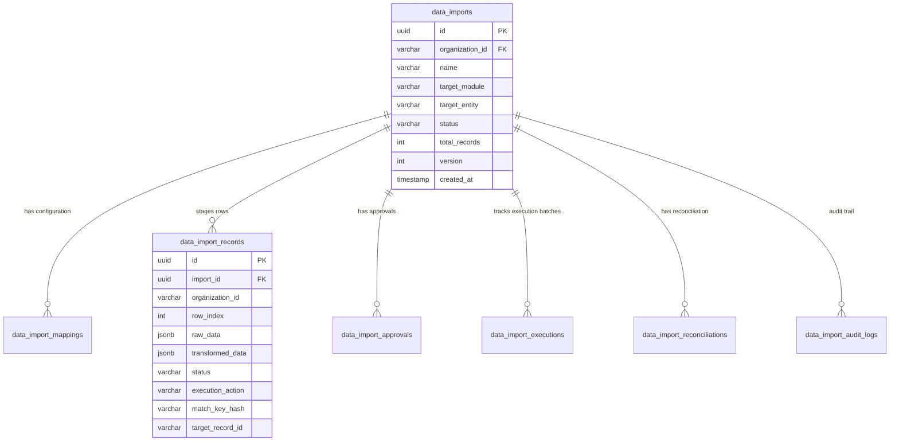

# DATA IMPORT CENTRE — DATABASE REFERENCE & SCHEMA INVENTORY

This document provides the complete inventory of PostgreSQL database tables, relationships, constraints, indexes, and lifecycle models in the Data Import Centre schema (`001_create_data_import_schema.sql`).

---

## 1. Relational Schema ERD

---

## 2. Table Specifications

### 2.1 `data_imports` (Aggregate Root)
- **Purpose**: Tracks top-level import metadata, lifecycle state, options, progress, and file paths.
- **Primary Key**: `id` (`UUID`)
- **Important Columns**: `organization_id`, `name`, `target_entity`, `status`, `total_records`, `version`, `storage_path`, `checksum_sha256`, `retry_count`.
- **Indexes**:
  - `idx_data_imports_org_status` ON (`organization_id`, `status`)
  - `idx_data_imports_org_created` ON (`organization_id`, `created_at` DESC)
- **Constraints**: Multi-tenant isolation via `organization_id` on all queries.

---

### 2.2 `data_import_mappings`
- **Purpose**: Stores source column to target field mappings, transformations, and default values.
- **Primary Key**: `id` (`UUID`)
- **Foreign Key**: `import_id` REFERENCES `data_imports(id)` ON DELETE CASCADE
- **Important Columns**: `column_mappings` (`JSONB`), `unmapped_behavior`, `default_values` (`JSONB`), `is_valid`.
- **Indexes**: `idx_mappings_import_id` ON (`organization_id`, `import_id`)

---

### 2.3 `data_import_records` (Staged Rows)
- **Purpose**: High-throughput table holding raw, transformed, validated, matched, and executed row state.
- **Primary Key**: `id` (`UUID`)
- **Foreign Key**: `import_id` REFERENCES `data_imports(id)` ON DELETE CASCADE
- **Important Columns**: `row_index`, `raw_data` (`JSONB`), `transformed_data` (`JSONB`), `status` (`PENDING`, `VALID`, `INVALID`, `WARNING`, `SKIPPED`, `EXECUTED`, `FAILED`), `execution_action` (`CREATE`, `UPDATE`, `SKIP`, `NONE`), `match_key_hash`, `target_record_id`, `validation_errors` (`JSONB`), `execution_error`.
- **Indexes**:
  - `idx_records_import_status` ON (`organization_id`, `import_id`, `status`)
  - `idx_records_match_key` ON (`organization_id`, `match_key_hash`)
  - `idx_records_row_index` ON (`import_id`, `row_index`)

---

### 2.4 `data_import_approvals`
- **Purpose**: Records immutable governance decisions, approver ID, comments, and SHA-256 state snapshot hashes.
- **Primary Key**: `id` (`UUID`)
- **Foreign Key**: `import_id` REFERENCES `data_imports(id)` ON DELETE CASCADE
- **Important Columns**: `decision` (`APPROVE`, `REJECT`, `INVALIDATED`), `decided_by`, `decided_at`, `snapshot_hash`, `reason`.

---

### 2.5 `data_import_executions`
- **Purpose**: Tracks batch execution runs, processing durations, and throughput counts.
- **Primary Key**: `id` (`UUID`)
- **Foreign Key**: `import_id` REFERENCES `data_imports(id)` ON DELETE CASCADE
- **Important Columns**: `batch_size`, `successful_creates`, `successful_updates`, `skipped_records`, `failed_records`, `duration_ms`.

---

### 2.6 `data_import_reconciliations`
- **Purpose**: Row-by-row post-import verification records, audit metrics, and discrepancy logs.
- **Primary Key**: `id` (`UUID`)
- **Foreign Key**: `import_id` REFERENCES `data_imports(id)` ON DELETE CASCADE
- **Important Columns**: `status` (`FULLY_RECONCILED`, `PARTIALLY_RECONCILED`, `MISMATCHED`), `verified_records_count`, `mismatches_count`, `discrepancy_details` (`JSONB`).

---

### 2.7 `data_import_audit_logs`
- **Purpose**: Append-only immutable audit trail capturing every transition, user actor, timestamp, and IP address.
- **Primary Key**: `id` (`UUID`)
- **Foreign Key**: `import_id` REFERENCES `data_imports(id)` ON DELETE CASCADE
- **Important Columns**: `actor_user_id`, `action`, `from_state`, `to_state`, `details` (`JSONB`), `ip_address`, `timestamp`.
- **Indexes**: `idx_audit_org_import` ON (`organization_id`, `import_id`, `timestamp` DESC)
