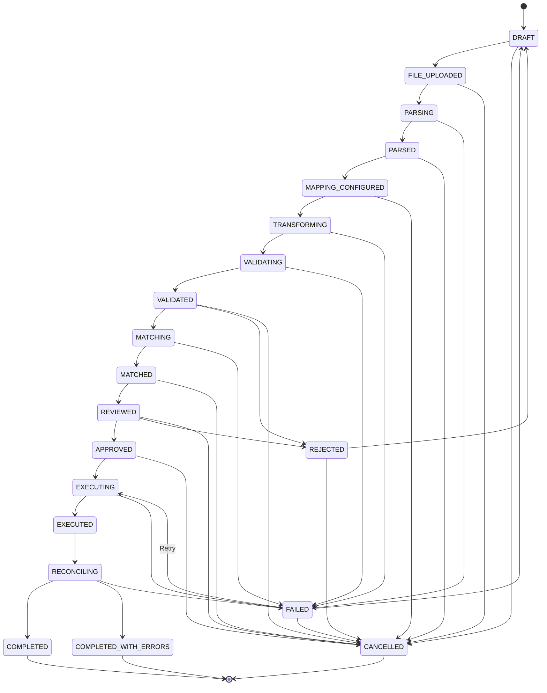

# DATA IMPORT CENTRE — FINAL ARCHITECTURE SPECIFICATION

## 1. System Overview
The **Data Import Centre** is an enterprise-grade, multi-tenant ingestion, mapping, transformation, validation, deduplication, review, approval, transactional execution, and post-import reconciliation engine designed for zero data loss, strict governance, and high-volume data imports.

---

## 2. Core Architectural Principles
1. **Separation of Concerns & Layered Design**:
   - **Infrastructure**: Parsers (CSV, XLSX, JSON, XML), storage, security validation, structured logging, Prometheus-compatible metrics.
   - **Domain State Machine**: Strict 20-state deterministic finite state machine with guarded transitions.
   - **Services Layer**: Entity Schema Registry, Column Normalization, Transformation Pipeline, 4-Tier Validation, Length-Prefixed Deduplication & Matching, 8-Point Review Checklist, Dual-Key Approval Governance, Transactional Batch Execution, Row-by-Row Reconciliation, Reporting, Selective Retry, Stalled Recovery, and Cleanup.
   - **Presentation / API**: RESTful Express controllers with tenant isolation, request validation, idempotency, and RBAC guards.

2. **Defense in Depth**:
   - MIME / Magic byte verification, path traversal checks, zip bomb defense, XXE neutralization, and CSV formula injection neutralization (`=`, `+`, `-`, `@`, `\t`, `\r`).
   - Separation of duties in approval workflows (creator cannot approve their own import without explicit bypass permission).
   - Cryptographic snapshot hashing (SHA-256) of approved staged data to guarantee execution immutability.
   - Concurrency locking with optimistic version checks and `ConflictError` rejection.

---

## 3. End-to-End Pipeline Data Flow

```text
Incoming File (CSV / XLSX / JSON / XML)
   │
   ▼
[1. File Security Validator] ── (Size, MIME, Path Traversal, Magic Bytes)
   │
   ▼
[2. Temporary Storage & Parsers] ── (Stream-based normalization into Raw Records)
   │
   ▼
[3. Column Normalization & Suggestion Engine] ── (Exact, Normalized, Alias, Fuzzy match)
   │
   ▼
[4. Transformation Pipeline] ── (13 Pure Transformers: trim, case, email, date, regex...)
   │
   ▼
[5. 4-Tier Validation Engine] ── (Syntax, Format, Business Rules, DB constraints)
   │
   ▼
[6. Deduplication & Target Matching] ── (Canonical token keys, composite collision defense)
   │
   ▼
[7. Automated Review Engine] ── (8-point checklist, summary statistics, conflict alerts)
   │
   ▼
[8. Approval Governance] ── (Segregation of duties, SHA-256 snapshot hashing, version lock)
   │
   ▼
[9. Transactional Execution] ── (Batch 500 rows, target mutations, idempotency, error capture)
   │
   ▼
[10. Post-Import Reconciliation] ── (Intended vs actual write verification, anomaly detection)
   │
   ▼
[11. Reporting & Audit Logging] ── (5-tier reports, safe CSV export, immutable audit trail)
```

---

## 4. State Machine Definition



---

## 5. Security and Tenant Isolation
- **Multi-Tenant Scoping**: All queries, state mutations, and lookups require an explicit `organizationId`. Cross-tenant requests produce immediate `UnauthorizedError` / `403 Forbidden`.
- **Object-Level Authorization**: Operations verify both user roles (`admin`, `operator`, `auditor`, `viewer`) and record ownership.
- **Audit Logging**: Every transition and mutation creates an immutable entry in `import_audit_logs` storing actor ID, tenant, event type, before/after states, timestamp, and IP address.
