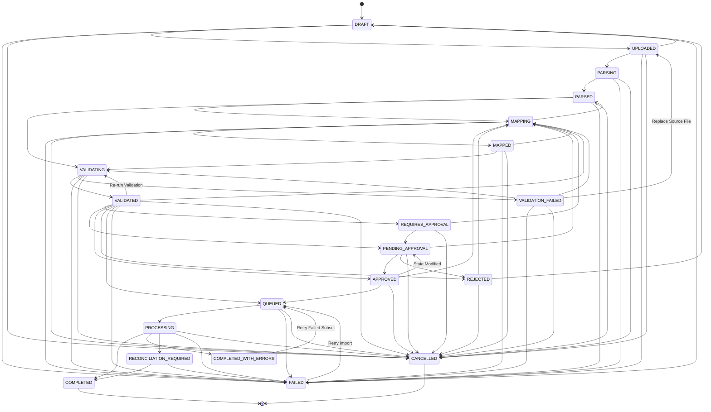

# DATA IMPORT CENTRE — STATE MACHINE SPECIFICATION

This document details the deterministic 20-state finite state machine implemented in `ImportStateMachine` (`src/domain/state-machine/import-state-machine.ts`).

---

## 1. State Lifecycle Diagram

---

## 2. Transition Guard Matrix & Authority

| Current State | Allowed Next States | Trigger / Condition | Initiating Actor | Failure Behavior |
| :--- | :--- | :--- | :--- | :--- |
| **DRAFT** | `UPLOADED`, `FAILED`, `CANCELLED` | File uploaded & magic bytes verified | Creator / Uploader | Remains in `DRAFT` |
| **UPLOADED** | `PARSING`, `DRAFT`, `FAILED`, `CANCELLED` | File staging confirmed | Ingestion Worker / Uploader | Transitions to `FAILED` |
| **PARSING** | `PARSED`, `FAILED`, `CANCELLED` | File parser extracts headers & sample rows | Parser Worker | Transitions to `FAILED` |
| **PARSED** | `MAPPING`, `VALIDATING`, `FAILED`, `CANCELLED` | Headers discovered & type inferred | Operator | Transitions to `FAILED` |
| **MAPPING** | `MAPPED`, `PARSED`, `FAILED`, `CANCELLED` | Column mappings submitted & verified | Operator | Remains in `MAPPING` |
| **MAPPED** | `VALIDATING`, `MAPPING`, `FAILED`, `CANCELLED` | All required fields mapped | Operator | Transitions to `MAPPING` |
| **VALIDATING** | `VALIDATED`, `VALIDATION_FAILED`, `FAILED`, `CANCELLED` | 4-tier validation engine executed | Validation Worker | Transitions to `VALIDATION_FAILED` |
| **VALIDATED** | `VALIDATING`, `PENDING_APPROVAL`, `APPROVED`, `QUEUED`, `REJECTED`, `MAPPING`, `FAILED`, `CANCELLED` | Validation passed; may be re-run after source or mapping changes | System / Operator | Transitions to `FAILED` |
| **PENDING_APPROVAL**| `APPROVED`, `REJECTED`, `MAPPING`, `CANCELLED` | Formal review completed | Lead / Approver | Transitions to `REJECTED` |
| **APPROVED** | `QUEUED`, `PENDING_APPROVAL`, `MAPPING`, `CANCELLED` | Segregation of duties & SHA-256 hash locked | Lead / Approver | Invalidated on state edit |
| **QUEUED** | `PROCESSING`, `FAILED`, `CANCELLED` | Worker dequeues batch job | Execution Worker | Transitions to `FAILED` |
| **PROCESSING** | `COMPLETED`, `COMPLETED_WITH_ERRORS`, `RECONCILIATION_REQUIRED`, `FAILED`, `CANCELLED` | 500-row batch writes execute | Execution Worker | Transitions to `FAILED` |
| **COMPLETED_WITH_ERRORS** | `QUEUED` | Retry triggered for retryable failures (≤3 retries) | Operator | Rejects if max retries exceeded |
| **FAILED** | `QUEUED`, `DRAFT` | Manual or automated retry triggered | Operator / Sweeper | Blocked if non-retryable |
| **COMPLETED** | *None (Terminal)* | Import fully executed & reconciled | System | Transitions rejected |
| **CANCELLED** | *None (Terminal)* | Explicit user cancellation | Operator / Admin | Transitions rejected |

---

## 3. Prohibited & Illegal Transitions
The state machine strictly forbids and rejects:
- `DRAFT` -> `PROCESSING` / `COMPLETED` (cannot bypass parsing, mapping, validation, approval).
- `FAILED` -> `COMPLETED` (cannot skip execution or recovery).
- `APPROVED` -> `COMPLETED` (must transition through `QUEUED` and `PROCESSING`).
- `COMPLETED` -> Any state (terminal state is immutable).
- `CANCELLED` -> Any state (cancelled jobs cannot be reopened).
